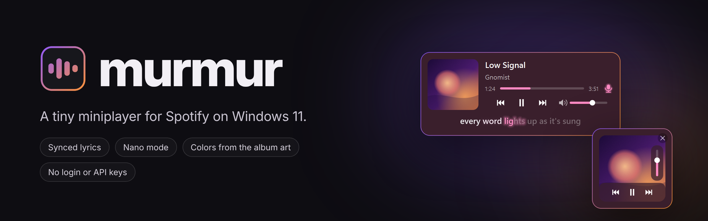

# Murmur Miniplayer

A small always-on-top miniplayer for Spotify on Windows 11, with synced karaoke-style lyrics.

It reads what Spotify is playing from the Windows media session, so there's no Spotify login or API key.

### [⬇ Download Murmur.exe](https://github.com/gn0mist/murmur/releases/download/v0.2.0-beta/Murmur.exe)

Free · Windows 10/11 · v0.2.0-beta · [all releases](https://github.com/gn0mist/murmur/releases)

**Status:** public beta (v0.2.0). It works day to day, but expect a few rough edges.

## Download

[Download Murmur.exe](https://github.com/gn0mist/murmur/releases/download/v0.2.0-beta/Murmur.exe)
and run it. No install and no Python needed. Just have the Spotify desktop app open.

Windows may show "Windows protected your PC" the first time, because the app
isn't code-signed. Click **More info → Run anyway**.

## Features

- Album art, title, artist, progress bar (click to seek)
- Back / play / next and a volume slider on hover
- Synced lyrics from [LRCLIB](https://lrclib.net), highlighted word by word
- Colors that follow the album art
- Nano mode (double-click to toggle)
- Mouse wheel over the player changes Spotify's volume
- Right-click for opacity, nano mode, always on top, lock position, and more

## Requirements

- Windows 10/11
- The Spotify desktop app

## Run from source

Needs Python 3.10+.

```
python -m pip install -r requirements.txt
python murmur.py
```

Rename the file to `.pyw` to run it without a console window.

## Build the .exe

```
python -m pip install -r requirements.txt pyinstaller
python -m PyInstaller murmur.spec
```

The result is `dist/Murmur.exe`.

## Files it creates

- `~/.murmur.json`: settings and window position
- `~/.murmur_lyrics/`: lyrics cache

Settings and the lyrics cache from the earlier `spotify_miniplayer` name are
carried over automatically on first run.

## License

MIT. See [LICENSE](LICENSE).

---

Gnomist · Praxis 1
